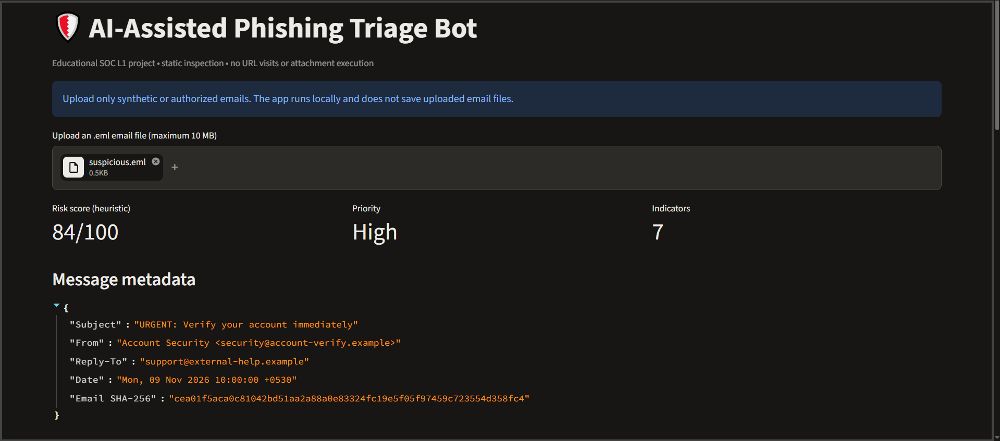
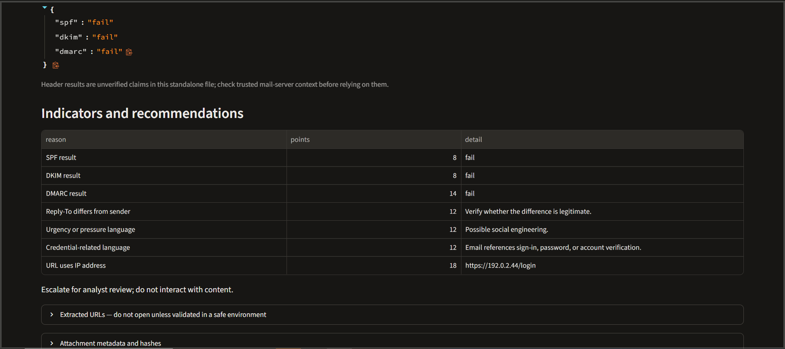
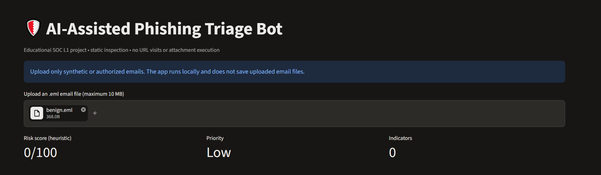
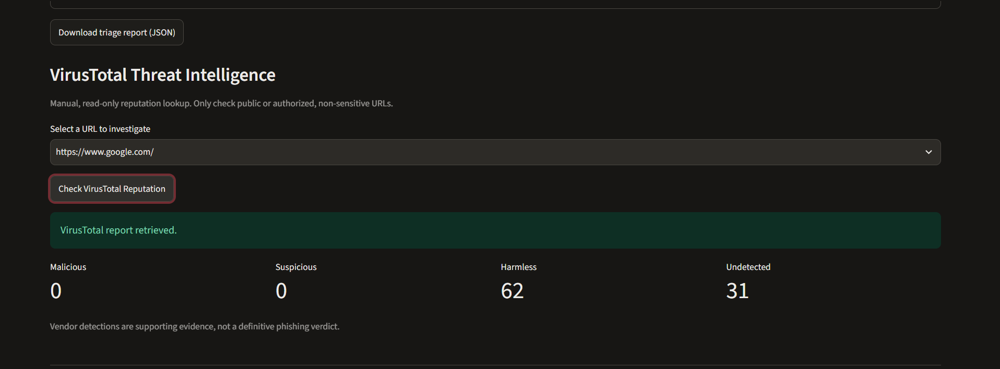
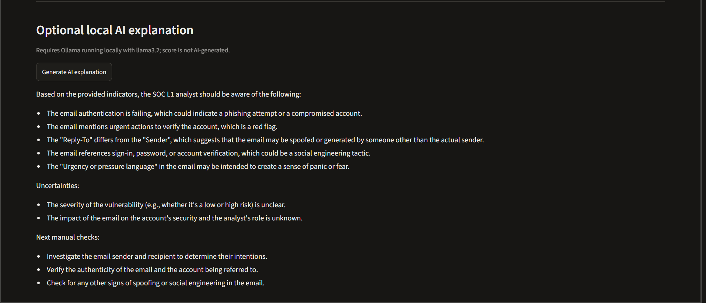

# AI-Powered Phishing Triage Bot

### SOC Analyst L1 | Email Security | Threat Intelligence | Local AI

An AI-assisted phishing email investigation application built using Python, Streamlit, VirusTotal API, and Ollama (Llama 3.2 1B).

The project simulates a SOC Level 1 analyst workflow by extracting email indicators, applying heuristic risk scoring, enriching URLs with threat intelligence, and generating AI-assisted investigation explanations.

## Project Overview

The application accepts `.eml` email files and performs static analysis to identify potential phishing indicators.

It assigns a heuristic risk score, recommends an investigation priority, and supports analyst-led triage.

**All demonstration emails are synthetic.**

## Technology Stack

- Python 3
- Streamlit
- VirusTotal API v3
- Ollama — Llama 3.2 1B
- Pytest
- Git and GitHub

## Key Features

- Email header and metadata extraction
- SPF, DKIM, and DMARC header-result inspection
- Sender and Reply-To mismatch detection
- Credential-harvesting language detection
- Urgency and social engineering keyword detection
- IP-based URLs and Punycode domain identification
- URL shortener and insecure HTTP detection
- Excessively long URL detection
- Suspicious attachment extension detection
- SHA-256 attachment hashing
- Optional read-only VirusTotal URL reputation lookup
- Local AI-generated phishing investigation explanations
- JSON investigation report export
- Risk-based analyst escalation recommendations

## Detection Workflow

1. A SOC analyst uploads an `.eml` email.
2. The Python analyzer extracts headers, URLs, and attachment metadata.
3. Heuristic detection rules identify suspicious patterns.
4. The application calculates a risk score from 0 to 100.
5. The analyst reviews the detected indicators.
6. The analyst can optionally retrieve an existing VirusTotal URL reputation report.
7. Ollama generates a supplementary AI explanation.
8. The analyst reviews findings and exports a JSON report.

**Risk classification:**

| Risk Score | Priority |
|---|---|
| 0–29 | Low |
| 30–59 | Medium |
| 60–100 | High |

The score is heuristic and does not represent a calibrated probability of phishing.

## Project Screenshots

### 1. Phishing Email Detection



### 2. Phishing Indicators



### 3. Benign Email Analysis



### 4. VirusTotal Threat Intelligence



### 5. Local AI Explanation



## Evaluation Results

The detection engine was evaluated against six synthetic labeled email scenarios.

| Metric | Result |
|---|---:|
| Total evaluated emails | 6 |
| True positives | 2 |
| True negatives | 3 |
| False positives | 0 |
| False negatives | 1 |
| Accuracy | 83.33% |
| Precision | 100% |
| Recall | 66.67% |

For this evaluation, Medium and High priority were considered flagged for analyst review.

One subtle phishing scenario was missed, demonstrating a limitation of keyword- and heuristic-based detection.

These results are specific to the small synthetic dataset and do not represent real-world detection accuracy.

See [Evaluation Details](docs/evaluation_results.md).

## Installation

Clone the repository:

```bash
git clone https://github.com/prajnakr10-commits/ai-phishing-triage-bot.git
cd ai-phishing-triage-bot
```

Create a virtual environment:

```bash
python -m venv .venv
```

Activate it on Windows:

```cmd
.venv\Scripts\activate
```

Install dependencies:

```bash
pip install -r requirements.txt
```

Run the application:

```bash
python -m streamlit run app.py
```

Open the local Streamlit URL shown in your terminal.

## Optional VirusTotal Configuration

Create `.streamlit/secrets.toml`:

```toml
VT_API_KEY = "YOUR_API_KEY"
```

Never publish this file or expose the API key in screenshots.

VirusTotal lookups are manual and read-only. The application retrieves existing reports rather than submitting unknown URLs for scanning.

## Optional Local AI Setup

Install Ollama from its official website.

Download the model:

```bash
ollama pull llama3.2:1b
```

Start the Ollama server and ensure the model is available.

The local AI generates supplementary explanations based on the structured investigation report.

The deterministic phishing score is not generated by the language model.

## Testing

Run the automated tests:

```bash
python -m pytest -q
```

Run the synthetic evaluation:

```bash
python evaluate.py
```

## Security Considerations

- Suspicious URLs are extracted without being opened.
- Attachments are analyzed statically and are not executed.
- VirusTotal API credentials are stored outside version-controlled source code.
- Synthetic email examples are used for project demonstrations.
- AI outputs require human validation.
- Email authentication results are parsed from headers and are not independently verified against trusted mail-server logs.

## Limitations and Future Improvements

This is an educational SOC laboratory project, not a production email security gateway.

Future improvements include domain impersonation detection, HTML link-destination comparison, better treatment of authentication-header trust, larger evaluation datasets, and improved identification of subtle phishing attempts.

## SOC Analyst Skills Demonstrated

Email security analysis, phishing investigation, indicator extraction, threat intelligence enrichment, alert prioritization, incident documentation, Python automation, and AI-assisted security operations.

## Disclaimer

This project is intended for cybersecurity learning and authorized defensive analysis only. No real phishing campaign, production SOC deployment, or confirmed compromise is represented by the synthetic demonstrations.
